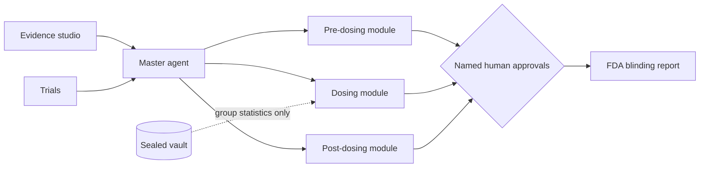
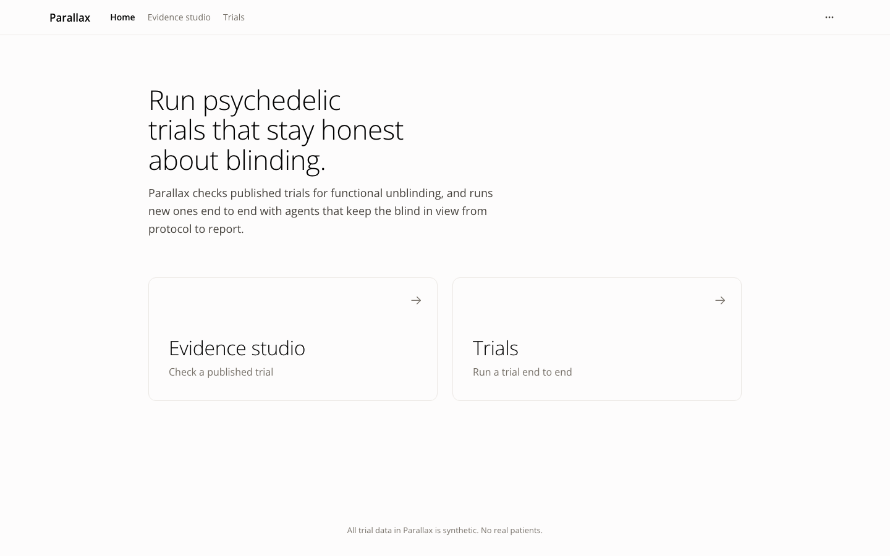
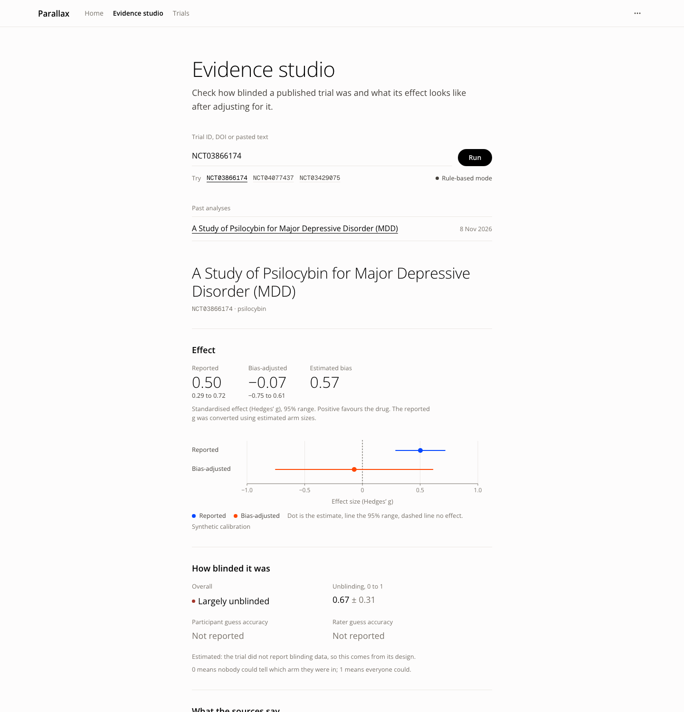

# Parallax

**Parallax: AI agents that run psychedelic trials so they measure and control the bias that sinks them.**

Live: https://parallax-two-tau.vercel.app/

Parallax is a web app with two parts. The **Evidence studio** checks a published trial for how well its blinding held and what its effect looks like after adjusting for that. **Trials** runs a new, simulated trial end to end, with AI agents working at every stage from protocol to FDA report and a named human signing every decision that changes the trial.

Built at Agentverse 2026 (Biotech track) by Danny, Izzy and Callum.

**Data:** no patient data is used. Every person in the app is synthetic and labelled; every real number is published and cited. See [DATA.md](DATA.md) for what each dataset is and where it came from.

## The problem

- **Functional unblinding.** In psychedelic trials, patients and the raters scoring them can usually tell who got the drug. Their expectations (**expectancy**: what someone believes the treatment will do) then inflate the measured effect. [1]
- **Blinding is rarely checked.** A 2026 systematic review in JAMA Psychiatry of 112 randomised psychedelic trials found only 29.5% assessed whether blinding held. Psilocybin, LSD and ayahuasca studies frequently reported blinding failure above 90%, and inert-placebo MDMA trials above 85%. [1]
- **It has already cost an approval.** In June 2024 an FDA advisory committee voted 9 to 2 that the efficacy of MDMA-assisted therapy for PTSD was not shown, with functional unblinding a central concern. [3] In August 2024 the FDA declined to approve it and asked for another phase 3 trial. [2]
- **The advantage may be expectation.** A March 2026 JAMA Psychiatry analysis (Szigeti, Williams and colleagues) compared psychedelic trials with open-label antidepressant trials: the psychedelic advantage disappeared, with both improving by about 12 points. Szigeti called unblinding "the defining methodological problem of psychedelic trials". [4]
- **Regulators now ask for it.** The FDA's final guidance (July 2026) names functional unblinding as the central threat and asks for blinding questionnaires, expectancy measures, **central raters** (blinded raters who are not at the dosing session) and alternative controls. [5]
- **Effects are small.** Compass COMP005 beat placebo by 3.6 points on the **MADRS** (a 60-point clinician-rated depression scale) [7]; COMP006 beat a 1 mg dose by 3.8 points [6]. Bias of this size can decide the result.

**Problem statement.** Psychedelic trials cannot tell drug effect from expectation, because almost nobody measures blinding while the trial runs. Regulators now demand that evidence, and no tool produces it as a routine part of running a trial.

## Our solution

Agents live inside the trial from protocol to FDA report and measure blinding the whole way, using one standard measurement set, **UNBLIND-BLIND-1**: each participant and rater gives a guess (drug or control), their confidence and their expectancy at fixed timepoints.

- A **master agent** coordinates three modules: pre-dosing, dosing and post-dosing.
- Every trial-changing action needs a **named human's sign-off**.
- Allocation lives in a **sealed vault** that the AI cannot read. Agents only get group statistics, and groups smaller than 5 are suppressed "so no individual allocation can be inferred" (`MIN_CELL = 5` in `unblind/platform/core.py`).



## How to use it

Open https://parallax-two-tau.vercel.app/. Home has two doors: **Evidence studio** ("Check a published trial") and **Trials** ("Run a trial end to end").



> **2-minute demo path**
> 1. **Evidence studio**: click the **NCT03866174** chip and read the Effect section.
> 2. **Trials** > **Create a trial** > **Example: psilocybin for TRD** > **Create trial** > **Launch trial**.
> 3. **Design review**: type your name, click **Approve selected**, and watch the checklist and blinding risk update.
> 4. **Screening**: approve the **Clinician shortlist**; apply as a volunteer with "I was diagnosed with bipolar disorder last year".
> 5. **Dosing**: click **Advance a week** until the Site B drift action appears, then approve it.
> 6. **Follow-up**: ask a leading question and see the bias gate. **Report**: sign the FDA blinding report.

### A. Evidence studio

1. Click **Evidence studio** in the top nav.
2. In **Trial ID, DOI or pasted text**, paste a trial ID (try `NCT03866174`, or click one of the **Try** chips), a DOI or text, then click **Run**. It can take up to a minute.
3. Read **Effect**: the **Reported** and **Bias-adjusted** effect (Hedges' g, 95% range). Read **How blinded it was** (unblinding from 0, nobody could tell, to 1, everyone could).
4. Under **What the sources say**, click any fact to see the exact quote and source.
5. Under **Design fixes, best first**, click **Use these fixes in a new trial**. This opens a new trial draft built from the report.



### B. Run a trial

The vertical stepper on the right shows the stages: Draft, Design review, Recruitment, Screening, Dosing, Follow-up, Report.

1. **Create.** Go to **Trials** and click **Create a trial**. Pick a **Starting point**: **Blank page**, **Example: psilocybin for TRD** (treatment-resistant depression, scored on the MADRS) or **Example: MDMA for PTSD** (scored on the **CAPS-5**, the standard clinician-rated PTSD scale). Click **Create trial**.

2. **Draft.** Edit the protocol as a document, then click **Launch trial**.

3. **Design review.** See **Blinding risk** (predicted unblinding from 0, coin flip, to 1, everyone knows) and the FDA July 2026 **Blinding checklist**. In **Review design fixes**, type your name as **Reviewer**, keep the fixes ticked and click **Approve selected**. Each approved fix adds a sentence to the protocol, saves a new version and re-checks it. You can also edit the protocol yourself and click **Save version and re-check**.

4. **Recruitment.** Read the drafted **Recruitment ads** with their checks, and the **Measurement plan** (click **View measurement plan**).
5. **Screening.** The **Screening funnel** shows Applied, Eligible (auto), Excluded (auto), Needs clinician and Enrolled. Click **View screening ledger** to see flagged applicants with the quoted disclosure. Sign the **Clinician shortlist** with **Approve** to enrol participants.

6. **Dosing.** Move time with **Advance a day**, **Advance a week** or **Play**. The blinding monitor charts guesses from check-ins and raters (vault aggregates only). When raters at Site B drift, the agent proposes an action; approve it.

7. **Follow-up.** In the researcher portal, ask a leading question (for example one that assumes the drug worked). The bias gate rejects or rewrites it.

8. **Report.** Sign the FDA blinding report.

### C. The volunteer application view

On the **Screening** stage, below the funnel, is the volunteer application form. Fill it in as an applicant. Free text such as "I was diagnosed with bipolar disorder last year" is not decided automatically: it goes to a clinician, with the quote.

### Tips

- The vertical stepper on the right shows where you are. On phones it becomes a row of dots.
- The Gemini key is held on the server. Without it, Parallax runs in **Rule-based mode**.
- If a "This trial has expired" screen appears, start a new one. The project keeps its draft: click **Open the draft to launch it again**.

## Results from simulation

All numbers below are **SYNTHETIC** (simulated trials and applicants, no real patients).

| What | Result (SYNTHETIC) |
|---|---|
| Screening 500 simulated applicants | About 89% decided automatically; 56 sent to a clinician; all 29 hidden free-text exclusions caught |
| Psilocybin draft after design fixes | FDA checklist from 0/8 to 4/8; predicted unblinding from 0.79 to 0.55 |
| Drift detection | Planted drift caught in 18 of 20 simulated trials, a median of 13.5 days after onset, vs 62 days with an end-of-trial check |

## Honest limits

- Synthetic data only. No real patients.
- The bias-adjusted effect is a conservative estimate under stated assumptions, not "the true effect".
- Parallax lowers the risk of a rejection on blinding grounds. It does not guarantee approval.
- Clinicians stay in the loop: a clinician confirms the shortlist and every flagged case.
- Prior work exists (Szigeti et al. [4]). Our contribution is making blinding measurement standard and live inside the trial.

## How it works

**Stack:** FastAPI backend (`backend/main.py`, served on Vercel through `api/index.py`), React + Vite + TypeScript frontend (`frontend/`), Postgres on Neon when `DATABASE_URL` is set (`unblind/platform/store.py`), deployed on Vercel (`vercel.json`), Gemini called server-side only.

```
backend/main.py                API: /api/health, /api/protocols, /api/trials/... (state, step, record,
                               approvals, kpis, modules), /api/evidence/run
api/index.py                   Vercel entry point for the API
frontend/                      React app (Home, Evidence studio, Trials, project workspace)
unblind/platform/              core.py (record, approvals, vault), store.py, world.py (SYNTHETIC simulator)
  master/                      master agent (orchestrator)
  predose/ dosing/ postdose/   the three modules
unblind/                       evidence pipeline used by the Evidence studio
data/ eval/ tests/             data, evaluations, tests
```

**Owners:** Danny: pre-dosing, master agent, API, frontend. Izzy: dosing. Callum: post-dosing.

**Module contract:** see [MODULE_CONTRACT.md](MODULE_CONTRACT.md).

The project was first called UNBLIND, so the Python package is still `unblind` and environment variables start with `UNBLIND_`.

## Run it locally

Python 3.12 (what the team develops and tests with; the repo does not pin a version) and Node.

```bash
pip install -r requirements-dev.txt
uvicorn backend.main:app --port 8000

npm ci --prefix frontend
npm run dev --prefix frontend      # Vite on 5173, proxies /api to 8000 (override with VITE_API_TARGET)
```

Environment variables (names only):

- `DATABASE_URL`: Postgres connection. Without it, trials are kept in a local file store.
- `GEMINI_API_KEY`: optional. Without it, rule-based mode is used.

Tests:

```bash
python -m pytest -q
```

Evidence pipeline (command line and the original Streamlit demo):

```bash
python -m unblind run NCT03866174
streamlit run app/app.py
```

## References

1. ICH. *E9(R1) Addendum on Estimands and Sensitivity Analysis in Clinical Trials.* FDA guidance, May 2021.
2. FDA. *Psychedelic Drugs: Considerations for Clinical Investigations.* Final guidance, July 2026. [Coverage](https://www.appliedclinicaltrialsonline.com/view/fda-finalizes-guidance-clinical-trial-design-psychedelic-drug-development)
3. Orsini DK, Wong S, Di Luch S, et al. Blinding integrity in psychedelic randomized clinical trials: a systematic review. *JAMA Psychiatry* 2026;83(7):755–769. [doi:10.1001/jamapsychiatry.2026.0255](https://doi.org/10.1001/jamapsychiatry.2026.0255)
4. Compass Pathways. COMP005 primary endpoint, 23 Jun 2025 ([release](https://www.biospace.com/press-releases/compass-pathways-successfully-achieves-primary-endpoint-in-first-phase-3-trial-evaluating-comp360-psilocybin-for-treatment-resistant-depression)); COMP006 primary endpoint, 17 Feb 2026 ([release](https://ir.compasspathways.com/News--Events-/news/news-details/2026/Compass-Pathways-Successfully-Achieves-Primary-Endpoint-in-Second-Phase-3-Trial-Evaluating-COMP360-Psilocybin-for-Treatment-Resistant-Depression/default.aspx)).
5. FDA Psychopharmacologic Drugs Advisory Committee, midomafetamine for PTSD, 4 Jun 2024 ([live coverage](https://www.hcplive.com/view/live-updates-fda-psychopharmacologic-advisory-committee-meeting-mdma-ptsd)); Complete Response Letter to Lykos Therapeutics, Aug 2024 ([coverage](https://www.biospace.com/drug-development/fda-rejects-lykos-mdma-assisted-ptsd-therapy-after-negative-adcomm)).
6. FDA. *Considerations for the Use of Artificial Intelligence to Support Regulatory Decision-Making for Drug and Biological Products.* Draft guidance, Jan 2025.
7. Szigeti B, et al., 2026 — reported in UCSF, "Are psychedelics better antidepressants? New study says no," Mar 2026. [ucsf.edu](https://www.ucsf.edu/news/2026/03/431651/are-psychedelics-better-antidepressants-new-study-says-no)

## Data sources

| Source | Licence |
|---|---|
| [ClinicalTrials.gov API v2](https://clinicaltrials.gov/data-api/api) (US NLM) | Public domain |
| [Europe PMC](https://europepmc.org/) | Per-article, recorded with each record |
| [JulesCan/clinicaltrial-protocol-corpus](https://huggingface.co/datasets/JulesCan/clinicaltrial-protocol-corpus) | CC0-1.0 |

No patient data is used. All performance figures in this repository are generated from synthetic simulations with planted ground truth and are not evidence of real-world performance.
